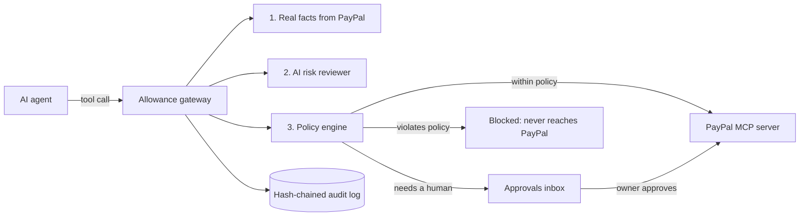

# Allowance: a spending firewall for AI agents, built on PayPal


**Hosted demo:** <paste your Render URL here> &nbsp;|&nbsp; **Video:** <paste your YouTube link here>

> AI agents are starting to touch real money. One poisoned invoice can talk an agent into refunding $600 to the wrong place.
> **Allowance sits between the agent and PayPal.** The agent proposes, a deterministic policy decides, an AI reviewer
> adds a second opinion, and a human has the last word.

Built for the [PayPal AI Hackathon](https://paypalaihackathon.devpost.com/). Sandbox only: no real money moves.

## The problem

Businesses want agents that issue refunds, answer disputes and chase invoices. But an agent that reads untrusted text
(invoices, emails, tickets) can be hijacked by instructions hidden in that text. Handing it unrestricted PayPal access is
too risky, and "please be careful" in a prompt is not a security control.

## What Allowance does

Allowance is an **MCP gateway in front of PayPal's official MCP server**. Every tool call an agent makes goes through it:



1. **Facts come from PayPal, never from the agent.** Before judging a refund, Allowance asks PayPal how big the original payment really was.
2. **An AI risk reviewer** reads the proposed action *and the document that led to it* and flags signs of manipulation ("the invoice orders the assistant to skip human approval"). It can only turn *allow* into *ask a human*, never the reverse.
3. **A deterministic policy engine** makes the actual decision: allow, ask a human, or block. Pure function, no network, 100+ tests.
4. **A human approves or denies** from a dashboard. A kill switch blocks everything instantly.
5. **Everything is written to a tamper-evident audit log** (each record hashes the one before it).

## Where AI is used (and where it is not allowed to decide)

| AI feature | What it does | Its limit |
|---|---|---|
| Tool-using agent | A model handles a support/finance inbox using PayPal tools | Has no special powers; every call goes through the gateway |
| AI risk reviewer | Explains why an action looks manipulated | Can only escalate to a human, never approve |
| Policy in plain English | "Never refund over $15 without asking me" becomes a drafted policy change | Output is only a *proposal*: strict validator + a before/after diff + the owner must click Apply |

Works with Groq (free tier, default model `openai/gpt-oss-120b`), Anthropic, or any OpenAI-compatible service.
With no key, a built-in **obedient agent simulator** (always fooled, by design) drives the demo.

## How PayPal is used

- **PayPal's official MCP server (`@paypal/mcp`)** executes approved actions (refunds, invoices, disputes...) in the sandbox.
- **PayPal REST API** supplies trusted facts (capture, dispute and order amounts) and the authorize/capture/void spikes.
- Verified end to end in the sandbox: an approved refund executed through the MCP server and completed.

## Run it (about 2 minutes, no keys needed)

```bash
git clone https://github.com/<your-username>/allowance.git
cd allowance
npm install
npm run dev
```

Open **http://127.0.0.1:8787/** (the four numbered steps under the headline walk you through it). Demo mode uses a simulated PayPal, so nothing needs credentials. Try, in order:

1. **Run the agent**: a normal refund passes, a vendor invoice with hidden instructions is stopped, a pushy dispute waits for you.
2. **Run Red Team**: 21 hostile calls (inflated refunds, invented tools, smuggled fields, a race condition, data leaks) plus 3 legitimate actions.
3. **Approvals inbox**: approve or deny what the agent was not allowed to do alone.
4. **Policy in plain English**: use a preset, or type a rule if you set an AI key.
5. **Simulate tampering**: watch the audit chain break and name the edited record.

### Optional: turn on real AI

```bash
cp .env.example .env     # then add one line:  GROQ_API_KEY=your_key   (free at console.groq.com)
npm run dev
```

### Optional: talk to the real PayPal sandbox

Add `PAYPAL_CLIENT_ID` and `PAYPAL_CLIENT_SECRET` (sandbox app) to `.env`, then:

```bash
npm run dev:live         # dashboard on the live gateway; open the link it prints
npm run smoke:live -- --capture=<a_sandbox_capture_id>   # scripted scenarios against real PayPal
```

In live mode the Red Team and the demo agent run in an **isolated simulated range**, so hostile tests can never move real money.

## The interface

- **Animated live diagram:** every request an agent makes is drawn as a dot travelling through the Allowance shield: green passes to PayPal, orange drops to *You decide*, red bounces back.
- **Built for phones and desktops:** one responsive layout, tested at 390px and 1440px wide with no sideways scrolling.
- **Dark and light themes** (remembered), and it respects the "reduce motion" setting.
- **Plain-language details:** the hidden instruction in the poisoned invoice is highlighted, every reason is a readable chip, and the kill switch turns the whole page edge red.

## How Allowance uses Render

The public demo is deployed from a [`render.yaml`](render.yaml) Blueprint (infrastructure as code):

- a **web service** with a **health check** (`/api/health`), so traffic only reaches a healthy instance
- **auto-deploy** on every push to `main`
- the AI key is a **secret environment variable** in Render's dashboard, never in the repo
- **per-visitor private sessions** (cookie) and a **shared hourly AI budget**, so a public link is safe to share
- a **visible footer** ("Hosted on Render · build abc1234") read from Render's own environment variables, and a `/api/health` endpoint that reports the platform and build
- an optional **cron job** that runs the Red Team against the production build every hour and fails loudly if any attack gets through

## Design decisions worth knowing

- **Fail closed.** Unknown tool, malformed arguments, missing facts, a crashed reviewer, any internal error: the answer is *block* or *ask a human*.
- **Strictest rule wins.** Rules only ever raise severity; none can cancel another's objection.
- **The "omitted amount" trap.** PayPal refunds the *entire* payment if `amount` is omitted. A naive limit check sees no amount and waves it through. Allowance treats omission as the full captured amount.
- **No double-spending the budget.** An allowed action is recorded before PayPal is called, under a lock (tested with 8 simultaneous refunds).
- **The agent cannot approve.** Approval is not an MCP tool; it exists only on the owner-side dashboard.
- **What you approve is what runs.** Parked requests are private copies; the agent mutating its object changes nothing.
- **No limit leaks.** A blocked agent is told *which rule* fired, not the dollar thresholds, so it cannot tune its attacks. (Malformed requests get format hints so an honest agent can fix mistakes.)
- **Bounded approvals inbox.** A compromised agent cannot bury the human under requests.
- **Per-visitor demo sessions** and a shared AI budget keep a public demo safe.

## Tests

```bash
npm test            # 128 tests: policy engine, gateway, adapters, agent, reviewer, policy compiler
npm run typecheck
npx tsx src/jobs/redteam-ci.ts   # the 21-attack Red Team as a pass/fail check (also runs in CI)
```

## Honest limitations

- Protection requires that the agent holds **no direct PayPal credentials** (Allowance holds them).
- The PayPal MCP access token is minted at start-up and lasts hours; restart the gateway daily.
- Disputes could not be exercised against the sandbox (it has none), so the demo simulates one; the REST lookup for them is untested against real data.
- The AI reviewer can be wrong. That is why it is advisory and the deterministic engine decides.

## Tools used

PayPal developer platform (sandbox, official MCP server, REST API), Model Context Protocol SDK, Groq (`openai/gpt-oss-120b`) and an
OpenAI-compatible adapter (Anthropic supported too), AG Grid Community (audit and ledger tables), Render (hosting, Blueprint, health check),
GitHub Actions (CI), Node.js, TypeScript, Vitest.
Built with AI coding assistance (Claude).

## License

MIT. See [LICENSE](LICENSE).
